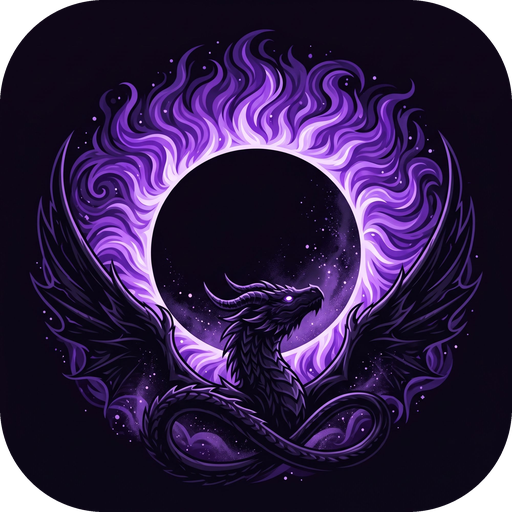

# CloudHollow

Story-driven Minecraft modpacks built around hands-on play, living characters and cinematic moments.

---

## Project Ecliptic

*The world has forgotten how to craft.*

Fires are cold, villagers no longer remember their crafts, and the Ender Dragon guards something that may be the last warm coal of everything that was lost. Project Ecliptic retells Minecraft's own journey as a story you play with your hands.

   

---

More packs will follow.

